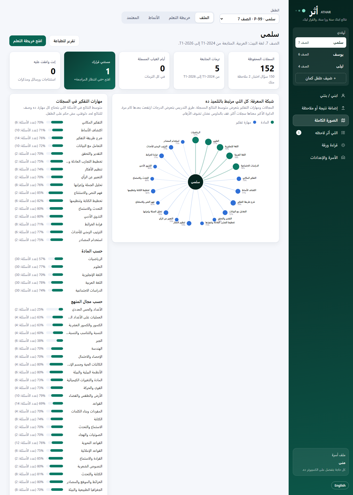
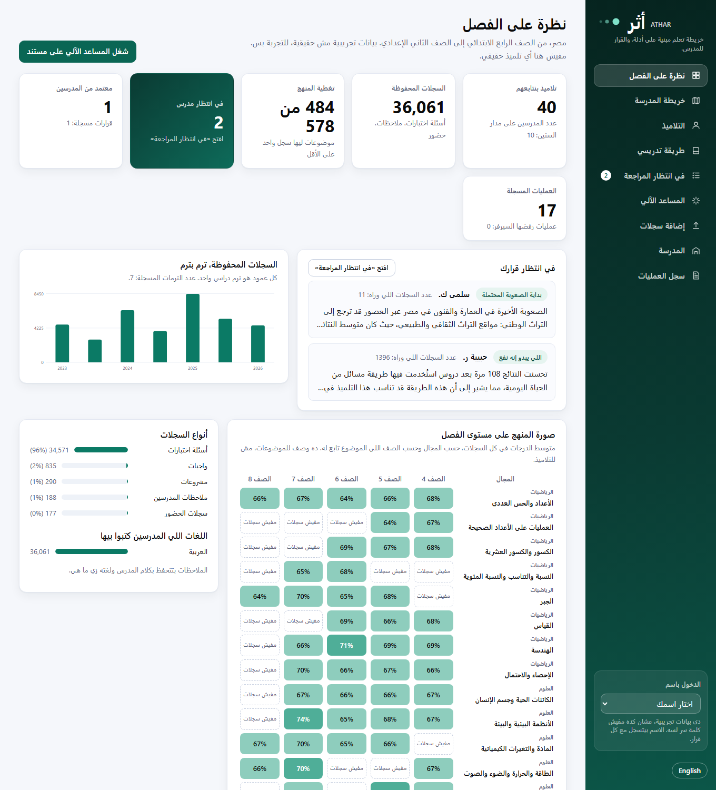
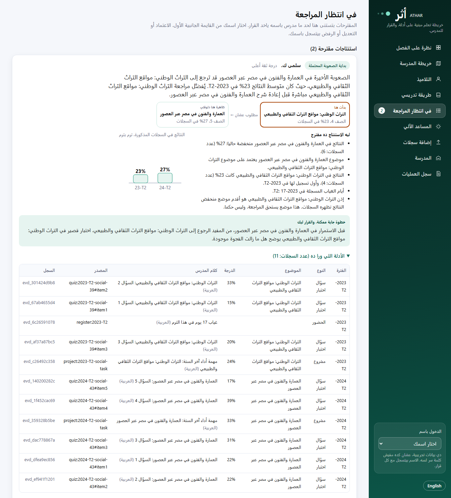

# عن أثر

أثر برنامج مجاني ومفتوح المصدر، بيحتفظ بنتائج الطفل في المدرسة سنة ورا سنة، وبيوريك هو كويس في إيه، وعنده صعوبة في إيه، والصعوبة ممكن تكون بدأت فين. الاسم معناه العلامة اللي الحاجة بتسيبها وراها.

برنامج واحد له ناحيتين. **ولي الأمر** بيستخدمه في البيت لأولاده. و**المدرس** بيستخدمه في المدرسة لفصوله. أثر بادئ بمصر، وبيغطي من الصف 4 الابتدائي للصف 2 الإعدادي في خمس مواد: الرياضيات والعلوم واللغة الإنجليزية واللغة العربية والدراسات الاجتماعية.

بيشتغل على الكمبيوتر بتاعك. مش محتاج إنترنت ولا حساب ولا اشتراك، ومفيش حاجة بتتبعت لأي مكان.

النسخة الإنجليزية: [ABOUT.md](ABOUT.md).

## المشكلة اللي بيحلها

درجة زي 12 من 20 بتقول إن الطفل لقى الامتحان صعب. لكن ما بتقولش ليه. وكتير السبب بيكون ورا بسنة أو سنتين: طفل مش عارف يتعامل مع الكسور في الصف 6 ممكن يكون ما اتمكنش من القسمة في الصف 4. الشهادات ما بتوضحش ده، وكل سنة دراسية جديدة بتبدأ من صفحة فاضية.

أثر بيحتفظ بالنتائج، وبيحطها على خريطة المنهج (578 موضوع، وكل موضوع معاه الموضوعات اللي بيتبني عليها)، وبيتتبع الصعوبة لحد أول موضوع ممكن تكون بدأت عنده. كده الكبير يعرف يبدأ المساعدة منين.

## بيعمل إيه لولي الأمر

- **بيحتفظ بكل النتائج في مكان واحد.** ضيف كل أولادك. كل طفل له صفحته، وبدوسة واحدة تتنقل بينهم.
- **بيقرا صورة الورقة المتصححة.** صوّر الورقة، وأثر يملا سطر لكل سؤال: الموضوع، والدرجة، والدرجة من كام. إنت بتراجع كل سطر قبل ما أي حاجة تتحفظ. وتقدر تكتب الدرجات بنفسك.
- **بيحتفظ بملاحظاتك**، عن اللي بتلاحظه وإنتو بتذاكروا سوا.
- **بيوريك إيه اللي ماشي كويس وتبدأ تساعد منين.** كل موضوع درجاته قليلة بيتتبعه لحد الموضوع الأقدم اللي الصعوبة ممكن تكون بدأت عنده، فتعرف تبدأ منين.
- **بيوريك اللي جاي السنة دي** ومبني على موضوع ضعيف، و**أسئلة ممكن تسألها للمدرس**.
- **بيرسم الصورة الكاملة.** شبكة معرفة ابنك في نصها، وحواليه المواد ومهارات التفكير، وخريطة تعلم تقدر تعيد عرضها ترم ورا ترم.
- **صريح لما المعلومات قليلة.** لو الدرجات قليلة بيقول إن اللي موجود مش كفاية عشان يحكم، وما بيقولش حاجة تانية.

أثر عمره ما بيقارن ابنك بأي طفل تاني، وما بيحطش تصنيف على ابنك. مهارات التفكير اللي بيعرضها بتوصف النتائج لحد دلوقتي.

## بيعمل إيه للمدرس

- **بيتابع كل تلميذ على مدار السنين**، مش الترم ده بس. المدرس الجديد بيشوف اللي السنين اللي فاتت وضحته.
- **نظرة على الفصل وخريطة المدرسة.** الفصل والمدرسة كلها واقفين فين، بالموضوع وبالصف. الصفحات دي بتوصف الموضوعات. مفيش صفحة بترتب التلاميذ.
- **تلميذ واحد بالتفصيل.** شبكة معرفة بتربط التلميذ بالمواد ومهارات التفكير وطرق التدريس والمدرسين، وخريطة تعلم فيها كل الموضوعات.
- **تتبع البداية.** دوس على موضوع ضعيف وشوف سلسلة الموضوعات الأقدم اللي وراه، عشان تعرف الصعوبة ممكن تكون بدأت فين.
- **أنماط مع الوقت.** إيه النتائج اللي فضلت ثابتة كذا ترم، وإيه طرق التدريس اللي جت بعدها نتائج أحسن.
- **في انتظار المراجعة.** كل استنتاج بيستنى مدرس باسمه، يعتمده أو يعدله أو يرفضه. وكل استنتاج معاه السجلات اللي وراه.
- **صفوف أو مواد زيادة.** المدرسة تقدر تضيف للمنهج من صفحة الفهرس بتاعة الكتاب. النموذج بيكتب الموضوعات ويقترح الروابط، ومدرس بيراجع كل واحد قبل ما يتستخدم.
- **طرق سهلة لإضافة السجلات.** كشف درجات تملاه بالإكسل، أو ورقة مكتوبة على الكمبيوتر المساعد الآلي يقراها.
- **تقرير يتطبع لكل تلميذ**، مبني على الاستنتاجات المعتمدة بس.
- **أدوات المدرسة.** تسجيل دخول للمدرسين، وفصول (المدرس بيشوف تلاميذه بس)، ونسخة احتياطية، وسجل بكل عملية ومين عملها.

## بيشتغل إزاي من جوه

1. **خريطة المنهج.** كل موضوع، وصفه وترمه، والموضوعات اللي محتاجها قبله.
2. **السجلات.** درجات وملاحظات وحضور، مربوطة بالموضوعات مع الوقت.
3. **كود عادي هو اللي بيوصل للاستنتاجات.** بيلاقي الأنماط اللي فضلت كذا ترم، وبيتتبع الصعوبة على الخريطة. نفس السجلات بتدي نفس الإجابة كل مرة.
4. **النموذج بيقرا وبيصيغ بس.** بيقرا صورة أو ورقة مكتوبة، وبيكتب الاستنتاج بكلام واضح. ما بيقررش حاجة.
5. **إنسان هو اللي بيعتمد.** المدرس في ناحية المدرسة، وولي الأمر في ناحية الأسرة. المساعد الآلي ما يقدرش يعتمد حاجة.

النموذج مفتوح الأوزان (Qwen 3.5، حجم 9B) وبيشتغل على نفس الكمبيوتر. قراية الصور والمستندات بس هي اللي محتاجاه. كل حاجة تانية بتشتغل من غير نموذج.

## اللي أثر عمره ما هيعمله

- يرتب التلاميذ، أو يقارن طفل بطفل تاني.
- يحط تصنيف على طفل، أو يحدد له مسار.
- يقول استنتاج من غير السجلات اللي وراه.
- يبعت سجلات طفل أو صوره بره الكمبيوتر.

## إزاي تجيبه

- **ولي أمر أو مدرس:** نزّل `Athar-windows-with-model.zip` من [فولدر أثر على جوجل درايف](https://drive.google.com/drive/folders/1Fg7QVpYEbY4f-Tua_oJ7YMvfS3-1tjMO)، وافتح ملف «ابدأ من هنا». النموذج جواه، ومش محتاج تثبت حاجة.
- **مبرمج:** الكود على [GitHub](https://github.com/OmarAxis/Athar). الخطوات في [دليل التشغيل](GETTING-STARTED.ar.md).

## الكمبيوتر محتاج إيه

- ويندوز 10 أو 11، نسخة 64 بت.
- حوالي 8 جيجا مساحة فاضية مع النموذج.
- رام 16 جيجا مريحة للنموذج. لو أقل، كل حاجة هتشتغل ما عدا قراية الصور والمستندات.

## واقف فين النهارده

أثر نسخة مبكرة، والصفحة دي لازم تتقرا على الأساس ده.

- اتجرب ببيانات مش حقيقية بس. لسه ما اتستخدمش مع مدرس حقيقي أو تلميذ حقيقي. ما تحطش بيانات تلاميذ حقيقية فيه دلوقتي.
- خرايط المنهج الخمسة مسودات. لسه مفيش مدرس راجعها، ولا راجع الصياغة العربي.
- قراية الصور شغالة كويس مع صورة واضحة ومعدولة لورقة مطبوعة. خط الإيد الحقيقي لسه ما اتجربش كفاية، وعشان كده إنت بتراجع كل سطر.
- اتشغل على كمبيوتر ويندوز واحد. مستخدمين ماك ولينكس يقدروا يشغلوه من الكود المصدري.

## مين اللي عامله

أثر من عمل Meska AI، ومفتوح المصدر برخصة Apache 2.0. طلع من Meska Brain، مشاركة في مسار التعليم في African Agentic AI Design Challenge.

