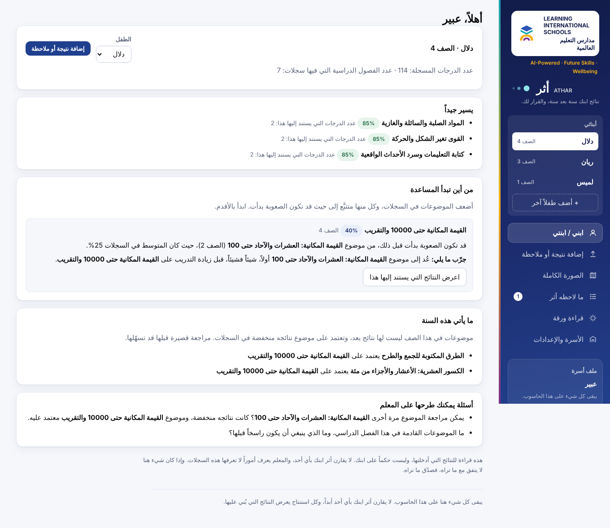
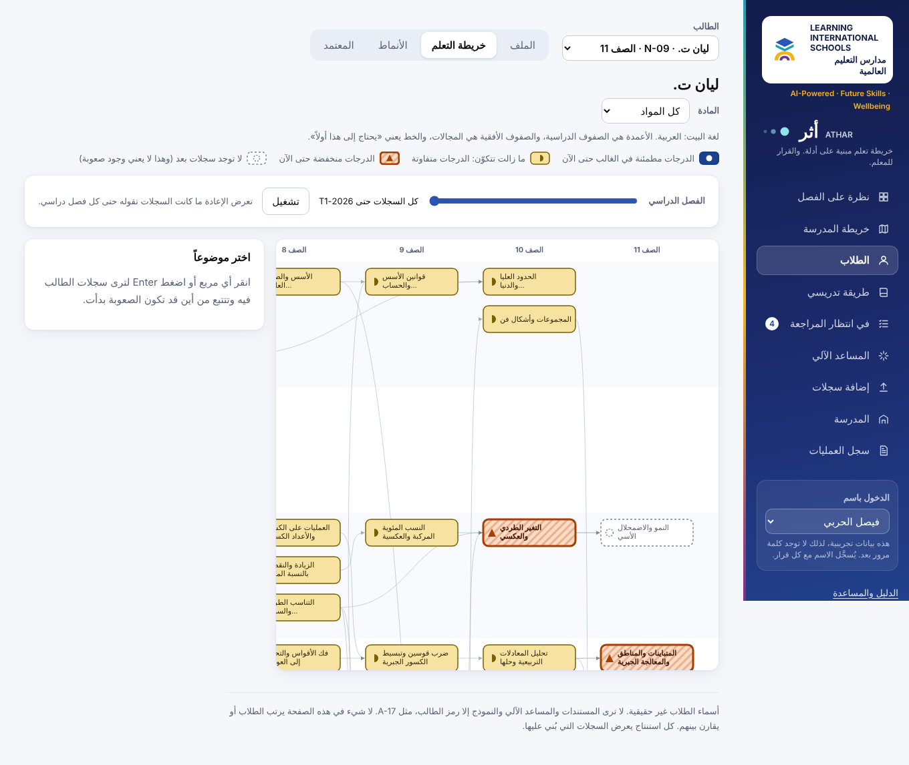

# عن أثر

أثر برنامج مجاني ومفتوح المصدر، يحتفظ بنتائج الطفل في المدرسة سنة بعد سنة، ويبيّن ما يُحسنه، وما يجد فيه صعوبة، ومن أين قد تكون الصعوبة بدأت. ومعنى الاسم: العلامة التي يتركها الشيء خلفه.

برنامج واحد له جانبان. **ولي الأمر** يستخدمه في البيت لأبنائه، و**المعلم** يستخدمه في المدرسة لفصوله. هذه النسخة معدّة لمدارس التعليم العالمية في المملكة العربية السعودية، وتغطي منهج كامبريدج من الصف الأول إلى الصف الحادي عشر (المرحلة الابتدائية والمتوسطة وIGCSE) في ثلاث مواد: الرياضيات والعلوم واللغة الإنجليزية.

يعمل على خادم المدرسة أو على حاسوبك. لا يحتاج إلى حساب ولا اشتراك لدى أي شركة.

النسخة الإنجليزية: [ABOUT.md](ABOUT.md).

## المشكلة التي يحلها

درجة مثل 12 من 20 تقول إن الطفل وجد الاختبار صعباً، لكنها لا تقول لماذا. وكثيراً ما يكون السبب قبل ذلك بسنة أو سنتين: طفل لا يتقن الكسور في الصف السادس قد يكون لم يتمكن من القسمة في الصف الرابع. الشهادات لا توضح ذلك، وكل سنة دراسية جديدة تبدأ من صفحة فارغة.

يحتفظ أثر بالنتائج، ويضعها على خريطة المنهج (298 موضوعاً، ومع كل موضوع الموضوعات التي يُبنى عليها)، ويتتبع الصعوبة حتى أول موضوع قد تكون بدأت عنده. وبهذا يعرف الكبار من أين تبدأ المساعدة.

## ماذا يقدم لولي الأمر

- **يحفظ كل النتائج في مكان واحد.** أضف جميع أبنائك. لكل طفل صفحته، وتنتقل بينهم بنقرة واحدة.
- **يقرأ صورة الورقة المصححة.** صوّر الورقة، فيملأ أثر سطراً لكل سؤال: الموضوع، والدرجة، والدرجة الكاملة. وأنت تراجع كل سطر قبل أن يُحفظ أي شيء، ويمكنك كتابة الدرجات بنفسك.
- **يحفظ ملاحظاتك** عمّا تلاحظه أثناء المذاكرة معاً.
- **يبيّن ما يسير جيداً ومن أين تبدأ المساعدة.** كل موضوع درجاته منخفضة يتتبعه حتى أقدم موضوع قد تكون الصعوبة بدأت عنده، فتعرف من أين تبدأ.
- **يبيّن ما يأتي هذه السنة** ويعتمد على موضوع ضعيف، و**أسئلة يمكنك طرحها على المعلم**.
- **يرسم الصورة الكاملة.** شبكة معرفة ابنك في وسطها، وحولها المواد ومهارات التفكير، وخريطة تعلم يمكنك إعادة عرضها فصلاً دراسياً بعد فصل.
- **صريح عندما تكون المعلومات قليلة.** إذا كانت الدرجات قليلة يذكر أن الموجود لا يكفي للحكم، ولا يقول شيئاً آخر.

لا يقارن أثر ابنك بأي طفل آخر أبداً، ولا يضع عليه تصنيفاً. ومهارات التفكير التي يعرضها تصف النتائج حتى الآن.

## ماذا يقدم للمعلم

- **يتابع كل طالب على مدى السنوات**، لا هذا الفصل الدراسي فقط. والمعلم الجديد يرى ما أوضحته السنوات الماضية.
- **نظرة على الفصل وخريطة المدرسة.** أين يقف الفصل والمدرسة كلها، حسب الموضوع والصف. هذه الصفحات تصف الموضوعات، ولا توجد صفحة ترتب الطلاب.
- **طالب واحد بالتفصيل.** شبكة معرفة تربط الطالب بالمواد ومهارات التفكير وطرق التدريس والمعلمين، وخريطة تعلم فيها كل الموضوعات.
- **تتبع البداية.** انقر موضوعاً ضعيفاً وشاهد سلسلة الموضوعات الأقدم التي يستند إليها، لتعرف من أين قد تكون الصعوبة بدأت.
- **أنماط عبر الزمن.** أي النتائج بقيت ثابتة عدة فصول دراسية، وأي طرق التدريس تبعتها نتائج أفضل.
- **في انتظار المراجعة.** كل استنتاج ينتظر معلماً مسمّى يعتمده أو يعدّله أو يرفضه، ومع كل استنتاج السجلات التي يستند إليها.
- **صفوف أو مواد إضافية.** تستطيع المدرسة الإضافة إلى المنهج من صفحة الفهرس في الكتاب، مثل اللغة العربية أو الدراسات الإسلامية. يكتب النموذج الموضوعات ويقترح الروابط، ويراجع معلم كل واحد منها قبل استخدامه.
- **طرق سهلة لإضافة السجلات.** كشف درجات تملؤه في Excel، أو ورقة مكتوبة على الحاسوب يقرؤها المساعد الآلي.
- **تقرير قابل للطباعة لكل طالب**، مبني على الاستنتاجات المعتمدة فقط.
- **أدوات المدرسة.** تسجيل دخول للمعلمين، وفصول (لا يرى المعلم إلا طلابه)، ونسخة احتياطية، وسجل بكل عملية ومن قام بها، وتشغيل على شبكة المدرسة وعلى الهواتف.

## كيف يعمل من الداخل

1. **خريطة المنهج.** كل موضوع، وصفه وفصله الدراسي، والموضوعات التي يحتاج إليها قبله.
2. **السجلات.** درجات وملاحظات وحضور، مرتبطة بالموضوعات عبر الزمن.
3. **برنامج عادي هو الذي يصل إلى الاستنتاجات.** يجد الأنماط التي استمرت عدة فصول دراسية، ويتتبع الصعوبة على الخريطة. السجلات نفسها تعطي الإجابة نفسها في كل مرة.
4. **النموذج يقرأ ويصوغ فقط.** يقرأ صورة أو ورقة مكتوبة، ويكتب الاستنتاج بلغة واضحة. ولا يقرر شيئاً.
5. **إنسان هو من يعتمد.** المعلم في جانب المدرسة، وولي الأمر في جانب الأسرة. ولا يستطيع المساعد الآلي اعتماد أي شيء.

النموذج مفتوح الأوزان (Qwen 3.5، بحجم 9B) ويعمل على الحاسوب نفسه. قراءة الصور والمستندات وحدها تحتاج إليه، وكل ما عداها يعمل بلا نموذج.

## ما لن يفعله أثر أبداً

- ترتيب الطلاب، أو مقارنة طفل بطفل آخر.
- وضع تصنيف على طفل، أو تحديد مسار له.
- قول استنتاج دون السجلات التي يستند إليها.
- إرسال سجلات طفل أو صوره خارج الحاسوب.

## كيف تحصل عليه

- **المدرسة:** الخطوات في [SCHOOL.md](../SCHOOL.md): تثبيته على خادم المدرسة، وإضافة الشعار، وتفعيل تسجيل الدخول، وتشغيله على الشبكة والهواتف.
- **مطوّر:** الخطوات في [دليل التشغيل](GETTING-STARTED.ar.md).

## ما يحتاج إليه الحاسوب

- ويندوز 10 أو 11 بنظام 64 بت، أو أي حاسوب يعمل عليه Python للتشغيل من الكود المصدري.
- نحو 8 غيغابايت من المساحة الفارغة مع النموذج.
- 16 غيغابايت من الذاكرة تكفي للنموذج براحة. وإذا كانت أقل، يعمل كل شيء ما عدا قراءة الصور والمستندات.

## أين يقف اليوم

أثر نسخة مبكرة، وينبغي قراءة هذه الصفحة على هذا الأساس.

- جُرّب ببيانات غير حقيقية فقط، ولم يُستخدم بعد مع معلم حقيقي أو طالب حقيقي. لا تُدخل فيه بيانات طلاب حقيقية الآن.
- خرائط منهج كامبريدج الثلاث مسودات كُتبت من المعرفة العامة بأطر كامبريدج. لم يراجعها معلم بعد، ولم تُطابَق مع كتب Marshall Cavendish التي تدرّسها المدرسة.
- قراءة الصور تعمل جيداً مع صورة واضحة ومستقيمة لورقة مطبوعة. ولم يُجرَّب خط اليد الحقيقي بما يكفي، ولذلك تراجع أنت كل سطر.

## من صنعه

أثر من عمل Meska AI، وهو مفتوح المصدر برخصة Apache 2.0. وهذه النسخة معدّة لمدارس التعليم العالمية.

