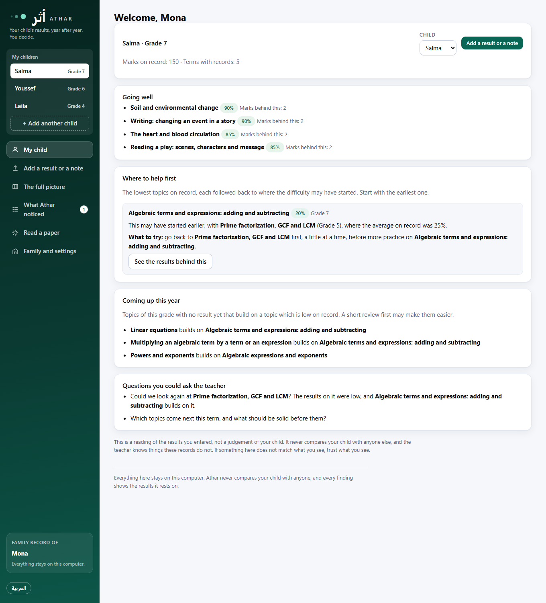
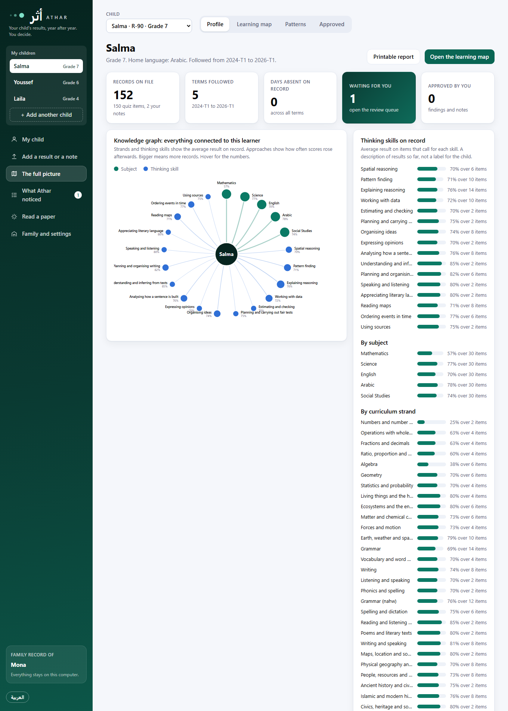
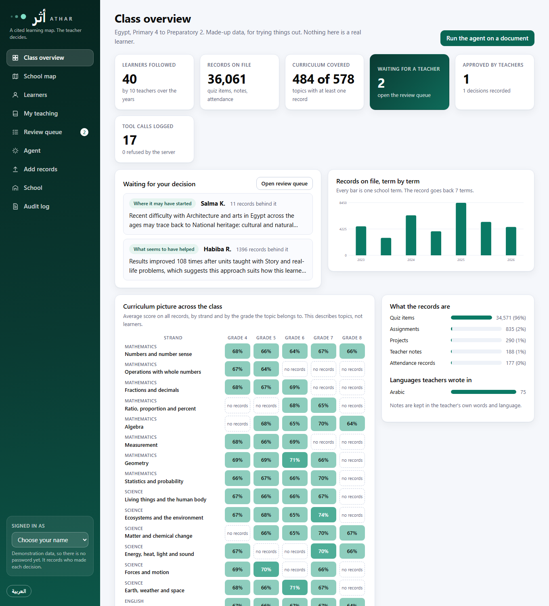
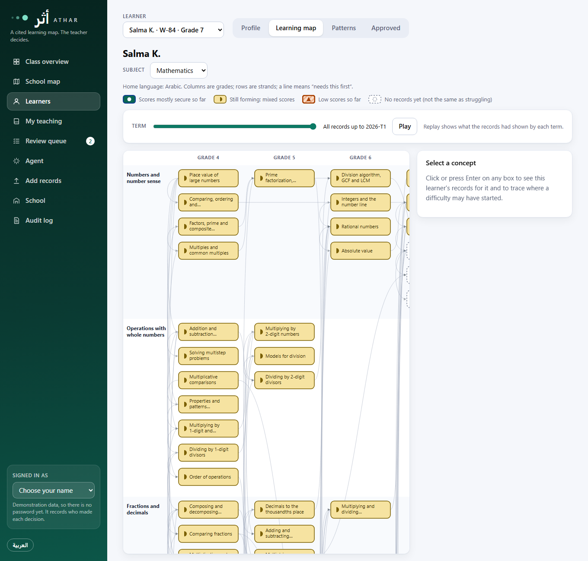
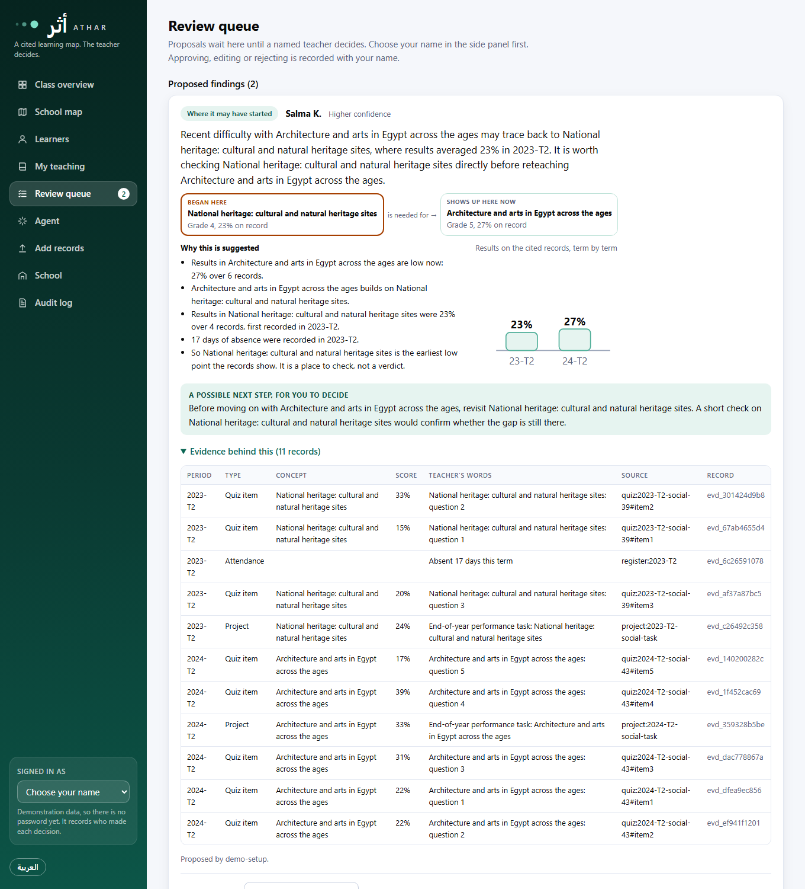

# About Athar

Athar is a free, open-source program that keeps a child's school results from year to year and shows where the child is doing well, where they struggle, and where a struggle may have started. The name is Arabic for a trace, the mark something leaves behind.

It is one program with two sides. A **parent** uses it at home for their own children. A **teacher** uses it at school for their classes. It starts with Egypt and covers grades 4 to 8 (Primary 4 to Preparatory 2) in five subjects: Mathematics, Science, English, Arabic and Social Studies.

It runs on the person's own computer. It needs no internet, no account and no subscription, and nothing is sent anywhere.

Arabic version: [ABOUT.ar.md](ABOUT.ar.md).

## The problem it answers

A mark such as 12 out of 20 says that a child found a test hard. It does not say why. Very often the reason sits one or two years back: a child who cannot work with fractions in grade 6 may never have been secure in division in grade 4. Report cards do not show this, and every new school year starts from an empty page.

Athar keeps the results, lays them over a map of the curriculum (578 topics, each with the topics it builds on), and follows a difficulty back to the earliest topic where it may have begun. That tells the adult where to start helping.

## What it does for a parent

- **Keeps every result in one place.** Add as many children as you have. Each child has their own page, and one click switches between them.
- **Reads a photo of a marked paper.** Take a photo, and Athar fills in one line for each question: the topic, the mark, and what it was out of. You check every line before anything is saved. You can also type the marks yourself.
- **Keeps your own notes**, about what you notice when you study together.
- **Shows what is going well and where to help first.** Each low topic is followed back to the earlier topic where the difficulty may have started, so you know where to begin.
- **Shows what is coming up this year** that builds on a weak topic, and **questions you could ask the teacher**.
- **Draws the full picture.** A knowledge graph with your child in the middle, the subjects and the thinking skills around them, and a learning map you can replay term by term.
- **Stays honest when it knows little.** With only a few marks it says there is too little to tell, and says nothing else.

Athar never compares your child with any other child, and it does not put a label on your child. The thinking skills it shows describe the results so far.

## What it does for a teacher

- **Follows each learner across years**, not only this term. A new teacher sees what the earlier years showed.
- **Class overview and school map.** Where the class and the whole school stand, by topic and by grade. These pages describe topics. No page ranks learners.
- **One learner in depth.** A knowledge graph that connects the learner to subjects, thinking skills, teaching approaches and teachers, and a learning map of every topic.
- **Trace back.** Click a weak topic and see the chain of earlier topics behind it, to find where the difficulty may have started.
- **Patterns over time.** Which results held over several terms, and which teaching approaches were followed by better results.
- **A review queue.** Every finding waits for a named teacher, who approves it, edits it or rejects it. Each finding lists the records behind it.
- **More grades or subjects.** The school can add to the curriculum from a contents page. The model lists the topics and suggests links, and a teacher checks every one before it is used.
- **Easy ways to add records.** A marks sheet you fill in with Excel, or a typed paper that the assistant reads.
- **A printable report for each learner**, built from approved findings only.
- **School tools.** Sign-in for teachers, classes (a teacher sees only their own learners), backup, and a log of every action and who did it.

## How it works inside

1. **A curriculum map.** Each topic, its grade and term, and the topics it needs first.
2. **The records.** Marks, notes and attendance, attached to topics over time.
3. **Plain code reaches the conclusions.** It finds patterns that held over several terms and traces a difficulty back along the map. The same records always give the same answer.
4. **A language model only reads and words.** It reads a photo or a typed paper and writes the finding in clear language. It does not decide anything.
5. **A person approves.** A teacher on the school side, the parent on the family side. The assistant cannot approve anything.

The model is an open-weights model (Qwen 3.5, 9B) that runs on the same computer. Only reading a photo or a document needs it. Everything else works without a model.

## What Athar will never do

- Rank learners, or compare one child with another.
- Label a child, or assign a track.
- State a finding without the records behind it.
- Send a child's records or photos off the computer.

## What is in this folder

| Item | What it is |
|---|---|
| `Start Athar` | Double-click to start. The app opens in your browser. |
| `Stop Athar` | Stops it. Closing the black window does the same. |
| `Guide (English)`, `Guide (Arabic)` | The guide with pictures and two short videos. It also covers what to do when something is not working. |
| `READ ME FIRST` | The short version of the guide, as plain text. |
| `About Athar` | This file. |
| `Screenshots` | Pictures of every main page, in English and in Arabic, for anyone who writes about Athar. |
| `models` | The model file, in the full package. |
| `data` | Your records. It appears after the first start. Back this folder up. |

## How to get it

- **A parent or a teacher:** download `Athar-windows-with-model.zip` from the [Athar folder on Google Drive](https://drive.google.com/drive/folders/1Fg7QVpYEbY4f-Tua_oJ7YMvfS3-1tjMO) and open `START HERE.txt`. The model is inside and nothing needs installing.
- **A developer:** the code is on [GitHub](https://github.com/OmarAxis/Athar). The steps are in [GETTING-STARTED.md](GETTING-STARTED.md).

## What the computer needs

- Windows 10 or 11, 64-bit.
- About 8 GB of free disk space with the model.
- 16 GB of memory is comfortable for the model. With less, everything except reading photos and documents still works.

## Where it stands today

Athar is an early version, and this page should be read with that in mind.

- It has been tried with made-up data only. It has not yet been used with a real teacher or a real learner. Do not put real learner data in it yet.
- The five curriculum maps are drafts. A teacher has not yet reviewed them, or the Arabic wording.
- Reading a photo works well on a clear, straight photo of a typed paper. Real handwriting has not been tested enough, which is why the person checks every line.
- It has been run on one Windows computer. Mac and Linux users can run it from the source code.

## Who makes it

Athar is made by Meska AI and is open source under the Apache 2.0 licence. It grew out of Meska Brain, an entry for the Education track of the African Agentic AI Design Challenge.
