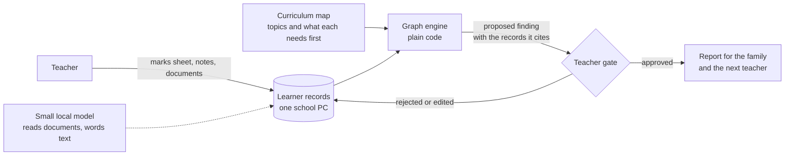
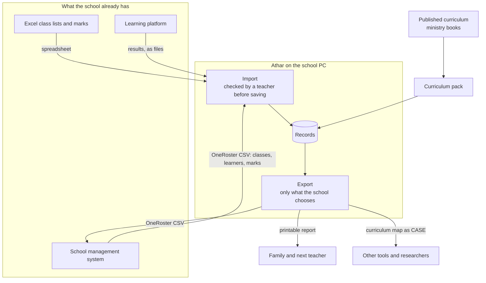
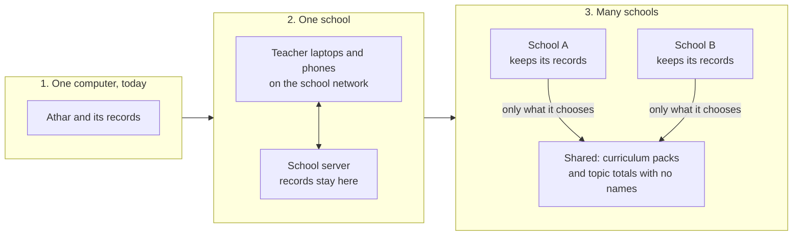

# Where Athar could go

This page is thinking, not a promise. Nothing here is built unless the [README](../README.md) says so. It is written for people who may want to build on Athar: what we think is worth doing next, how it could connect to the systems schools already have, how it could grow past one computer, and what we think should never be built.

If you only read one section, read [What does not change](#what-does-not-change).

## Where Athar is today

One school computer. A teacher puts in marks, notes and attendance. Each record is tied to a topic in a map of the curriculum. Plain code looks for patterns and traces a difficulty back to where it may have started. A named teacher approves every finding before it is used.

## Does something like this already exist?

We looked in November 2026. We did not find one product that puts all of Athar's parts together. That is the result of a limited search, not proof. Each part does exist somewhere:

| What exists | Examples | What it does not do |
|---|---|---|
| Tracing a gap back to an earlier topic | ALEKS, i-Ready (Prerequisites report), Squirrel AI | Closed products, online, built on their own tests and on other countries' curricula. Mostly student-facing. |
| Diagnosing a misconception from one wrong answer | Eedi | Mathematics only, built for the UK. |
| Offline, open source, with an Arabic interface | Kolibri | Delivers lessons and shows progress. It does not trace causes over years. |
| Open-source tutors and learner models | OATutor, pyBKT, Oppia | Research tools and tutors, not a school record. |
| A national record of each learner | Egypt's ministry and the Japanese company SPRIX announced a platform to track attendance and results from 2026/27 | Data goes up to the ministry. It is a different job from helping one teacher understand one learner. |

What we think is different about Athar:

- The evidence is the teacher's own marks, notes and attendance, not a vendor's question bank.
- Every finding lists the records it rests on, and a named teacher must approve it.
- It refuses to label or rank a child.
- Conclusions come from plain code that anyone can read, not from a model.
- The records stay on the school's computer.

The closest in how it works are i-Ready's prerequisite report and Squirrel AI's root-cause idea. The closest in how it is deployed is Kolibri. Sources are at the end. Some rows rest on our general knowledge of these products and were not checked again; they are marked there.

## Two sides: a school, and a family

Athar now asks, the first time it opens, whether a school or a parent is using it. The family side is built: a parent keeps their own child's results and notes at home and reads a short summary worked out from them. It is the same program and the same map, so a parent can show a school exactly what the school would get.

What the family side still needs, in order: reading a photo of a marked paper, so a parent does not have to type; a file a family can carry between home and school; and wording on every page that speaks to a parent, not a teacher.

The risk is particular to parents. A worried parent can turn "low in fractions since grade 4" into pressure on a child. So the family side leads with what is going well, says nothing when there is too little to tell, never compares, and keeps sending the parent back to the teacher.

## What does not change

Any future feature has to pass these. If an idea cannot, the idea is wrong, not the rule.

1. **A teacher decides.** The software proposes. A named person approves.
2. **Every claim cites its records.** No finding without evidence a teacher can open.
3. **No labels, no ranks, no tracks.** Athar describes patterns in the work. It never says what a child is, never compares children, never assigns a path.
4. **The records belong to the school and the family.** Nothing leaves the school's computer unless the school chooses to send it.
5. **It works with no internet.**
6. **The curriculum is the school's.** Athar maps it. It does not change it.
7. **Say what is not known.** A hole in the record is reported as a hole.

## Ideas, in the order we would do them

### First: make what exists right

These matter more than any new feature.

| Idea | Why | The risk |
|---|---|---|
| A review screen where a subject teacher checks the "needs this first" links one by one | The trace-back is only as good as the links, and today they are our draft | A reviewer in a hurry approves everything |
| Topic names checked against the printed books | Teachers must recognise every name | Books change each year |
| The Egyptian marking scheme (term work, monthly tests, the levels used in primary) | Teachers should not have to convert marks by hand | Getting it slightly wrong is worse than not having it |
| Correcting one mark on the page, with the old value kept | Mistakes happen | A quiet edit hides the mistake, so the change must be logged |
| A register of each family's consent: what for, until when, and how to withdraw | Egyptian law treats a child's data as sensitive and asks for a guardian's consent | A half-built register gives false comfort |
| Backups on a schedule, and to a second place | One lost computer should not lose years of records | A copy that leaves the building is a copy that can be lost |

### Next: help the teacher more

| Idea | Seen in | The risk |
|---|---|---|
| **Readiness view before a unit.** For next week's topic, which earlier topics have thin or low records for this class | i-Ready | It turns into ability groups. Show topics, not lists of children |
| **Questions that carry a misconception.** Each wrong answer points at a specific misunderstanding | Eedi | Writing good questions is slow, and guessing pollutes the evidence |
| **A marks sheet from a phone photo.** Read a handwritten sheet and show it to the teacher to confirm | Our own idea | Misread digits. Nothing is saved until the teacher confirms every row |
| **Voice note to a record.** A teacher speaks an observation in Arabic and it becomes a note | Our own idea | A recording of a child's name. Keep the text, not the audio |
| **A handover pack when a learner moves school.** One file the family carries, opened by the next school's Athar | Our own idea | The file is the whole record. It needs a password and the family's say |
| **Drafting help for the teacher.** A short quiz on a traced topic, for the teacher to edit | Khanmigo for Teachers | Model-written text entering the record unsourced. Drafts stay drafts |

### Later: grow carefully

| Idea | Seen in | The risk |
|---|---|---|
| More curricula as packs: other countries, other grades | Athar's own design | A map nobody local has reviewed |
| A shared library of reviewed packs, with who reviewed each | Kolibri's content library | It looks official when it is not |
| An estimate of how secure a topic is, shown beside the raw records | pyBKT | A number reads as a verdict. Known limit: the basic method assumes nothing is forgotten |
| Patterns across a school or district by topic | Research on early-warning systems | Ranking teachers or schools. Only topic totals, never names |
| A small Arabic model tuned for wording findings | Our own tries | We found the stock model's Arabic not good enough, so findings use fixed sentences today |

## Connecting to the systems schools already have

Most schools already keep class lists and marks somewhere, very often in Excel. Athar should take from those and give back to them, without becoming another place to type everything twice.

What we would use, and what we would skip:

| Standard | What it is for | Our view |
|---|---|---|
| Excel and CSV | What schools really have | First. A forgiving importer matters more than any standard. Athar already reads a marks sheet |
| OneRoster (1EdTech) | Class lists, classes and marks between school systems. It has a plain CSV form | Second. Import and export the CSV form |
| CASE (1EdTech) | Publishing a curriculum as data other tools can read | Good fit for sharing a curriculum pack. We must not make a draft map look official |
| xAPI | A common shape for "this learner did this" | Maybe, as a way to take results from learning platforms |
| LTI | Opening a tool from inside a learning platform | Little use for a tool that runs offline |
| Ed-Fi, SIF | Large district systems in other countries | Not for now |
| OpenEMIS | An open ministry information system used by some countries | Only if a ministry that uses it wants Athar |

What we do not know: which system Egyptian government schools use for marks today, and whether it can export anything. We could not establish that. Someone who works in a school can answer it in five minutes, and the answer decides what to build first.

About the ministry's own platform: Athar should not compete with it or copy data into it by default. A school could choose to export what the ministry asks for. That choice belongs to the school.

## Growing past one computer

Three sizes, each one optional. A school can stay at the first forever.

1. **One computer.** What exists now.
2. **One school.** The records live on one machine in the school. Teachers reach it from laptops or phones over the school's own network, with sign-in and HTTPS. A teacher sees their own classes. Needs: tested HTTPS, backups, and a way to work when the network is down and catch up later.
3. **Many schools.** Each school keeps its own records. What is shared is the curriculum packs and, if a school agrees, totals by topic with no names: "in these schools, fractions in grade 5 is where records are lowest". No learner's record goes to the centre. Moving a learner between schools is done by a file the family carries.

We would not build one central database of children. It is the simplest thing to build and the hardest to undo.

## What a long-term profile needs

Less than people expect. What matters is that each record is tied to a topic and a date.

Needed:

- A code for the learner that stays the same across years and schools.
- Which class, grade and school year they were in.
- Marks for each question or topic, not only a term total. A total of 14 out of 20 says nothing about where the gap is.
- Which topic each question tested.
- Attendance for each term.

Makes it much better:

- The teacher's short notes.
- How each topic was taught, so that "what seemed to help" can be seen.
- Who taught it.

Not needed, and better left out: family income, address, religion, health and behaviour records. They add risk and the analysis does not use them.

The hard part is not this list. Most schools keep only term totals, so the detail by topic has to start being written down. That is why the marks sheet with a topic row matters more than any other feature.

## The national platform, and where Athar fits

In August 2026 Egypt's Ministry of Education and Technical Education signed an agreement with SPRIX, a Japanese education company, for a national platform. As reported, teachers will record attendance and results on it, it will help schools see which students need support, and the ministry will receive updated data every day. It starts in several education departments in 2026/27 and then widens. SPRIX has worked on Egypt's mathematics curriculum since 2025. We found no public statement of who runs the data or of the privacy terms, and no report that it has launched.

Athar is not a rival to this and should not try to be. The two do different jobs.

| | The ministry platform | Athar |
|---|---|---|
| Who it serves | The ministry, looking at the whole system | One teacher, looking at one learner |
| The question it answers | Who is absent, who is failing | Why, and where it may have started |
| Where the data goes | To the ministry, daily | It stays in the school |
| How it comes | Under contract, closed | Open source, runs with no internet |

## Who would use it first

Three ways in, in the order we would try them.

1. **Private schools.** They choose their own software and are not waiting for the national platform. Private schools that follow the national curriculum can use the maps as they are. Language schools teach mathematics and science in English, and every topic in the maps has an English name as well as an Arabic one. This is where real teachers can use Athar soonest and tell us what is wrong with it. Schools on other curricula (British, American) would need their own packs.
2. **The "why" on top of the national platform.** If that platform can export marks, Athar could read them and add the trace-back. Nobody has confirmed that it can export.
3. **The curriculum map by itself.** A reviewed, open map of which topic needs which, for grades 4 to 8 in five subjects, does not seem to exist in public. It would be useful to the ministry, to SPRIX, to publishers and to researchers, whether or not they use the rest of Athar.

What a first private school pilot needs, before anything else on this page:

- one teacher per subject to review the maps and the Arabic;
- the consent, backup and HTTPS work listed in [SECURITY.md](../SECURITY.md) finished and tested;
- a school that agrees to try it with a few classes for one term, with the families' consent;
- someone to sit with the teachers in the first weeks and write down what they do not use.

## How it could pay for itself

The code is open, so the software is not what is sold. What a school could pay for:

- setting it up and moving its class lists and past marks in;
- training its teachers;
- curriculum packs reviewed by subject teachers, kept up to date as the books change;
- support, and a backup kept safely for the school.

One caution. Anyone paid to run software that holds children's records takes on the duties of the data protection law. That needs legal advice before the first contract, not after.

## What we will not build

Each of these has been built elsewhere and each has a known cost.

- **A risk score for a child.** A state system in the United States that flagged children as likely to drop out raised false alarms far more often for Black and Hispanic students than for White students, and students found the label hurtful. A separate study of the same system found the signal was mostly about the school, not the child.
- **Ranking learners, teachers or schools.**
- **Deciding a track, a stream or a subject for a child.**
- **A chatbot for children.** UNESCO's guidance suggests a minimum age of 13 for generative AI in class. Athar is for teachers.
- **Decisions with no person.** No finding is used until a named teacher approves it.
- **Selling or pooling learner data.**

## On the law

Egypt's Personal Data Protection Law (Law 151 of 2020) treats children's data as sensitive and asks for a guardian's consent. Rules issued in late 2025 add duties such as a written consent for younger children, a named data protection officer for organisations, and a short deadline for reporting a breach. We read this in law firms' summaries, not in the Arabic text, and we are not lawyers. A school must take its own legal advice before it holds real learner data in Athar. Until the consent register and the rest of the safety work are done, Athar is for made-up data only.

## If you want to build one of these

- Read [CLAUDE.md](../CLAUDE.md) for where things are in the code, and [SECURITY.md](../SECURITY.md) for what the code enforces.
- A new curriculum is a folder in `packs/`. Say where every topic comes from and who reviewed the links.
- A new way in for records goes through `imports.py`: check first, show the teacher, save only on confirm.
- Anything that returns learner data must respect classes (`classes.py`).
- Anything that writes a statement about a learner goes through the guard and a teacher gate.
- Write down what failed. `EVALS.md` shows how.

## Sources

Checked against the page in November 2026:

- ALEKS, Knowledge Space Theory: https://www.aleks.com/about_aleks/knowledge_space_theory
- i-Ready Prerequisites report: https://www.curriculumassociates.com/programs/i-ready-learning/classroom-math/prerequisites-report-interactive-walkthrough-abm
- Khanmigo for Teachers: https://blog.khanacademy.org/khanmigo-teachers-world-signup/
- Eedi, evaluation by the Education Endowment Foundation: https://educationendowmentfoundation.org.uk/projects-and-evaluation/projects/diagnostic-questions
- Kolibri: https://kolibri.readthedocs.io/en/latest/faq.html and https://blog.learningequality.org/universal-language-support-in-kolibri-2aef9bbb33c2
- OATutor: https://github.com/CAHLR/OATutor
- pyBKT: https://github.com/CAHLR/pyBKT
- Egypt's ministry platform, as reported: https://english.ahram.org.eg/News/574335.aspx
- SPRIX and Egypt's mathematics curriculum, as reported: https://en.amwalalghad.com/?p=214913
- The national platform in Arabic, as reported: https://filgamaa.com/?p=304862
- OneRoster 1.2: https://standards.1edtech.org/oneroster/specifications/standards/v1p2
- CASE: https://www.1edtech.org/standards/case
- OpenEMIS: https://en.wikipedia.org/wiki/OpenEMIS
- Deep knowledge tracing compared with simpler methods: https://arxiv.org/abs/1604.02416
- Early-warning system trial (in favour): https://air.org/news/press-release/new-study-shows-early-warning-intervention-and-monitoring-system-helps-get
- Early-warning false alarms (against): https://themarkup.org/machine-learning/2023/04/27/false-alarm-how-wisconsin-uses-race-and-income-to-label-students-high-risk
- The signal sits mostly at school level: https://arxiv.org/abs/2304.06205
- UNICEF guidance on AI and children: https://www.unicef.org/innocenti/reports/policy-guidance-ai-children
- UNESCO guidance on generative AI in education, as reported: https://news.un.org/en/node/1140477
- Egypt's data protection rules, law firm summaries: https://cms.law/en/are/legal-updates/egypt-s-pdpl-executive-regulations-issued-one-year-compliance-countdown-begins and https://www.tamimi.com/law-update/general/articles/from-policy-to-practice-egypt-issues-executive-regulations-of-the-personal-data-protection-law/

From general knowledge, not checked again for this page: that ALEKS and Squirrel AI are mainly student-facing, the details of Squirrel AI's method (we found no primary technical description), and what xAPI and LTI are for. Check these before quoting them.
